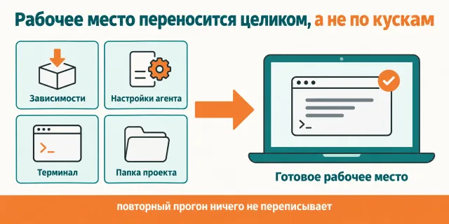
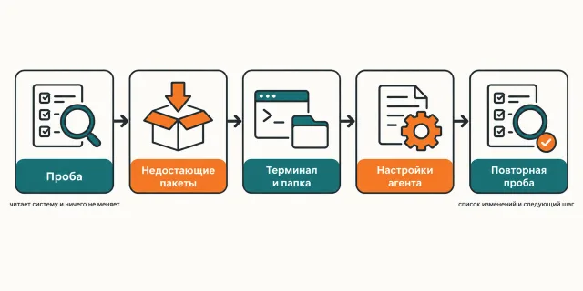

English · [Русский](README.md)

# Setting up Claude Code "the way he has it" takes two evenings inside someone else's configs, and it still comes out wrong

`/claudecode` builds the workbench one to one: the same dependencies, the same
`~/.claude` — settings, hooks, status line — the same terminal with the `cld` and `tld`
commands and a tab that opens straight in the working folder.

```
claude plugin marketplace add https://github.com/beCyborg/jadlis-claudecode.git
claude plugin install jadlis-claudecode@jadlis-claudecode
```

`CLAUDE.md` and the answer styles live in their own repos — [jadlis-claude-md](https://github.com/beCyborg/jadlis-claude-md)
and [jadlis-output-styles](https://github.com/beCyborg/jadlis-output-styles). `/claudecode` installs
them as a separate step if you agree.

This is the first and mandatory step of the Jadlis route: every other plugin assumes the
workbench is already there.



In words: on the left four pieces — dependencies, agent settings, terminal and project folder —
on the right the assembled workbench, and a second run rewrites nothing in it.

This is my workbench published as it is, not a product: whatever I stopped using, I removed.

## Before → after

| By hand | With an AI chat | With this plugin |
|---|---|---|
| **Where the config comes from.** You read someone's dotfiles and carry pieces over, guessing what depends on what. | It retells the documentation and offers an "example config" that never ran on its author's machine. | `assets/` holds an export of the owner's working files — the very ones he uses every day; `tools/export-owner.py` makes the export and strips keys, personal paths and personal MCP on the way out. |
| **What happens to your `settings.json`.** You copy someone's file over yours and lose your own keys. | It edits the JSON as text and breaks it on the first comma. | The merge runs through `jq`: the template wins for the keys it defines, yours survive, `env`, `permissions.allow` and `permissions.deny` are unioned, `pluginSecrets` is untouched, and the old file moves to `.bak-<date>`. |
| **How you learn what is missing.** You check one command at a time and forget what you already checked. | It asks about each package separately and loses the thread by the third. | `scripts/probe.sh` prints `key=PASS\|FAIL` for twenty-odd items at once — packages, terminal, `~/.claude`, folder — and changes nothing. |
| **The terminal.** You install iTerm2, then fiddle with the font, the colours and the working directory by hand. | It dictates mouse steps through settings that are named differently in your version. | The dynamic profile is dropped in as a JSON file, `$HOME/Jadlis` inside it is replaced by the real path, and the profile becomes the default one — a new tab lands in the working folder right away. |
| **Running it a second time.** It appends a second identical block to `.zshrc`. | It suggests "just add it at the end" and multiplies copies. | The block lives between markers and is replaced in place; all five scripts are idempotent — a second run prints `UNCHANGED` and writes not a byte. |

## How it works



Going in — a Mac that already has Claude Code on it.
Inside — the probe prints PASS/FAIL, only what is FAIL gets installed, and every overwrite
is preceded by a question.
Coming out — the assembled workbench and the list of what changed.

In words: probe → missing packages → terminal → folder → `~/.claude` → the probe again →
next step.

Nine steps. Each one first explains in plain language what it is and why, and only then
acts. Before an install and before any overwrite — a question.

1. **Probe.** `scripts/probe.sh`, a PASS/FAIL table. Changes nothing, installs nothing.
2. **Dependencies.** Only what is FAIL gets installed: Homebrew, `claude` natively
   (`curl -fsSL https://claude.ai/install.sh | bash`), then
   `brew install git jq node python@3.13 uv poppler tmux` and
   `brew install --cask iterm2 font-jetbrains-mono-nerd-font`.
3. **Terminal.** `~/.tmux.conf`, the iTerm2 profile and the `.zshrc` block between the
   `# >>> jadlis-claudecode >>>` markers. The block carries `cld`: it opens a tmux
   session named after the project (`repo`, `repo_2`, `repo_3`) and runs Claude Code in it.
4. **The folder.** `~/Jadlis/Система/Планы`, `~/Jadlis/.claude/rules` and a note on how
   work is done here: plan → verification → implementation.
5. **Instructions and styles — optional.** The skill asks, clones
   [jadlis-claude-md](https://github.com/beCyborg/jadlis-claude-md) and
   [jadlis-output-styles](https://github.com/beCyborg/jadlis-output-styles) into a temporary folder
   and runs their `install.sh --plan`, then `install.sh`. Your own `CLAUDE.md` is not replaced without a "yes".
6. **`~/.claude` one to one.** The `settings.json` merge, four hooks, `statusline-command.sh`,
   helper scripts, computer-use auto-approve and the switch to bypass after a plan is
   approved from the phone.
7. **The mode for a reader with ADHD.** Nothing to do: `output-styles/jadlis.md` from
   step 5 defines it, and `outputStyle: "Jadlis"` turns it on by default.
8. **Notifications — optional.** `jadlis-notifications` installs from the `jadlis`
   marketplace with a separate command. One manual step is left — enable the iTerm2 Python
   API so a click on a notification opens the right tab.
9. **The wrap-up.** The probe again, the list of changes and the next step: a new iTerm2
   tab → `cld` → `/jadlis-hub`.

The mechanical part sits in five small scripts — `probe.sh`, `apply-settings.sh`,
`apply-shell.sh`, `apply-iterm.sh`, `apply-claude-home.sh`. Each takes `--plan` (show the
diff, change nothing), each is idempotent, and each treats `$HOME` as the root, so the
whole set can be run against a throwaway home directory without touching anything.

What lands in the end:

| Piece | What exactly |
|---|---|
| Dependencies | Homebrew, native `claude`, `git`, `jq`, `node`, `python@3.13`, `uv`, `poppler`, `tmux`, iTerm2, JetBrains Mono Nerd Font |
| `~/.claude` | `settings.json`, four hooks, the status line, helper scripts, computer-use auto-approve in tmux, the switch to bypass after a plan is approved from the phone |
| Terminal | `~/.tmux.conf`, the "Jadlis" iTerm2 dynamic profile, the `.zshrc` block with `cld`, `tld` and `cc` |
| Folder | the `~/Jadlis` skeleton and the note "Приёмы работы — Claude Code" |
| Optional | `CLAUDE.md` with the writing rules and `rules/` from `jadlis-claude-md`, the Jadlis and Jadlis Voice styles from `jadlis-output-styles`, the `jadlis-notifications` plugin |

Terminal commands:

- `cld` opens a new tmux session named after the project (`repo`, `repo_2`, …) and runs
  Claude Code in it. `cc` is the same.
- `tld` with no argument lists all tmux sessions with their Claude Code titles; `tld <name>`
  switches to a session.
- Computer-use auto-approve: the "Computer Use wants to control these apps" dialog in a
  session inside tmux is confirmed on its own.
- Switch to bypass: a plan approved from the phone (Remote Control) makes the session go to
  bypass, clear the context and start the implementation in a clean window.

**Do not install the `jadlis-plan-bypass` plugin next to it.** Its hook is now part of this
setup. With both installed, the hook fires twice: `claude plugin uninstall jadlis-plan-bypass@jadlis`.

## Installing and the first run

**a) Text to paste to an agent.** Copy the whole thing into a Claude Code chat:

```
You are the installer. Install the plugin jadlis-claudecode from GitHub on this Mac.
This plugin needs no keys, so ask me for nothing secret.
Run exactly these commands, verbatim, shortening nothing:
1. claude plugin marketplace add https://github.com/beCyborg/jadlis-claudecode.git
2. claude plugin install jadlis-claudecode@jadlis-claudecode
3. claude plugin list — show me the line about jadlis-claudecode and its version.
After that tell me in one line: type /claudecode.
Before each command show it to me in full and wait for "yes". If I say "no", do not run
it, tell me what you skipped, and move on.
If a command returns an error, stop, show me the output, and do not move to the next one.
```

**b) Commands by hand.**

```
claude plugin marketplace add https://github.com/beCyborg/jadlis-claudecode.git
claude plugin install jadlis-claudecode@jadlis-claudecode
claude plugin list
```

The first command installs nothing — it adds the marketplace. Only the second one
installs, and one line removes it:
`claude plugin uninstall jadlis-claudecode@jadlis-claudecode --keep-data`.

The shared Jadlis marketplace installs the same plugin:
`claude plugin marketplace add https://github.com/beCyborg/jadlis-hub.git`, then
`claude plugin install jadlis-claudecode@jadlis`. Use one of the two ways, not both. The full HTTPS URL is
required: the short `owner/repo` form clones over SSH, and a new user usually has no SSH key.

**c) The short command.** Open Claude Code and type:

```
/claudecode
/claudecode статус
```

`/claudecode` and the full form `/jadlis-claudecode:claudecode` are the same thing.
`статус` runs only the probe and stops, installing nothing.

The first step after the install is the probe; it reads the system and changes nothing,
so it is safe to run just to look.

## Limits, cost, updating

**What it does not touch.** `pluginSecrets`, API keys and the macOS Keychain — keys
arrive at their own tier. An existing `~/.claude` file that differs from the template:
it shows the diff, waits for an explicit "yes", and moves the old one to `.bak-<date>`.
Lines of `.zshrc` outside the markers, and someone's own `~/.tmux.conf` without
permission. The default iTerm2 profile is not switched until it asks:
`defaults write com.googlecode.iterm2 "Default Bookmark Guid" …` runs behind a separate
flag. It does not create `~/Jadlis/CLAUDE.md` or the note structure — that is
`jadlis-obsidian`'s job.

**What you need.** macOS: the iTerm2 profile, `defaults`, Homebrew and
`~/Library/Application Support` are all Mac things, so the plugin does not work on Linux
or Windows. A Claude **Max** plan: the template sets `model: "claude-opus-5-5"` (Opus 5.5,
a 1M-token window by default), and on Pro that model burns usage credits. Claude Code
2.1.280 or newer: earlier versions do not know this model. Readiness for
`permissions.defaultMode: "bypassPermissions"` —
the agent runs commands and edits files without asking every time; the value is visible
in the diff before the write and can be changed. Everything that gets installed is free:
Homebrew, the CLI tools, iTerm2, the font, tmux.

The built-in Claude Code auto-updater is off (`DISABLE_AUTOUPDATER=1`): the CLI is
updated by `~/.claude/scripts/tools-autoupdate.sh`, which `cld` starts in the background
no more than once every six hours. It is the only updater.

**How tokens get spent.** A run is light: there are no subagents and no fan-outs here,
the work is a handful of commands and reading their output. What makes the workbench
expensive is not the install but what it switches on: the main model is `claude-opus-5-5`,
at effort `high` in `modelSettings`. `xhigh` is not set for the whole session: it is set
per agent, in the agent's own settings, and only single agents at the end of a chain get
it — analysis and synthesis, validators, critics — plus the browser and desktop operators.
There the extra depth pays off; on code and in mass subagents `xhigh` only spends the
weekly quota faster.

**Verified where I work:** my Mac (Apple Silicon, macOS 27), my Max subscription. macOS only:
on an Intel Mac the Homebrew path differs (`/usr/local`) — the only known difference, and one
I have not tested myself.

**Computer-use auto-approve confirms every app**, as on the owner's Mac: terminals,
Finder and System Settings too. Deny list — one regex line in `~/.config/jadlis/cu-deny-apps`,
details in `skills/claudecode/references/settings.md`.

**License.** Apache-2.0, see [LICENSE](LICENSE).

**Updating.** With a third-party marketplace, auto-update is off on your side: until you
run the first command you keep the version you installed.

```
claude plugin marketplace update jadlis-claudecode
claude plugin update jadlis-claudecode@jadlis-claudecode
claude plugin list
```

Installed through the Jadlis marketplace — the same commands with `jadlis` instead of
`jadlis-claudecode` after `@` and in `marketplace update`.

**Updating from 1.x.** Version 2.0.0 no longer installs `CLAUDE.md`, `rules/` and the styles,
but does not remove them either: the files from 1.x stay in place. `jadlis-notifications`
used to arrive as a dependency — install it explicitly, or `claude plugin prune` removes it:
`claude plugin install jadlis-notifications@jadlis`.

**Rollback.** The scripts delete nothing. Before each replacement they keep the old file next
to it: `~/.claude/settings.json.bak-<date>`, `~/.tmux.conf.bak-<date>`, `<file>.bak-<date>` in
`~/.claude/hooks` and `~/.claude/scripts`. To roll back, copy the `.bak` over the file.

A reinstall, if something landed crooked:

```
claude plugin uninstall jadlis-claudecode@jadlis-claudecode --keep-data
claude plugin install jadlis-claudecode@jadlis-claudecode
```
