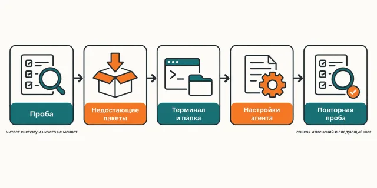

Русский · [English](README.en.md)

# Настроить Claude Code «как у него» — это два вечера в чужих конфигах, и всё равно получается не то

`/claudecode` собирает рабочее место один в один: те же зависимости, тот же
`~/.claude` — настройки, хуки, строка состояния, — тот же терминал с командами `cld` и
`tld` и вкладка, которая открывается сразу в рабочей папке.

```
claude plugin marketplace add https://github.com/beCyborg/jadlis-claudecode.git
claude plugin install jadlis-claudecode@jadlis-claudecode
```

`CLAUDE.md` и стили ответа живут в своих репо — [jadlis-claude-md](https://github.com/beCyborg/jadlis-claude-md)
и [jadlis-output-styles](https://github.com/beCyborg/jadlis-output-styles). `/claudecode` ставит их
отдельным шагом, если ты согласишься.

Это первый и обязательный шаг маршрута Jadlis: остальные плагины исходят из того, что
рабочее место уже собрано.


Текстом: слева четыре куска — зависимости, настройки агента, терминал и папка проекта, —
справа собранное рабочее место, и повторный прогон в нём ничего не переписывает.

Это моё рабочее место, выложенное как есть, а не продукт: чем перестал пользоваться — убрал.

## Было → стало

| Руками | Чатом с ИИ | Этим плагином |
|---|---|---|
| **Откуда берётся конфиг.** Читаешь чужие дотфайлы и переносишь куски, гадая, что от чего зависит. | Пересказывает документацию и предлагает «пример конфига», который у автора никогда не работал. | В `assets/` лежит выгрузка рабочих файлов владельца — те самые, с которыми он работает каждый день; выгрузку делает `tools/export-owner.py` и на выходе вычищает ключи, личные пути и личные MCP. |
| **Что происходит с твоим `settings.json`.** Копируешь чужой файл поверх своего и теряешь свои ключи. | Правит JSON текстом и ломает его на первой же запятой. | Слияние через `jq`: шаблон побеждает по своим ключам, чужие остаются, `env`, `permissions.allow` и `permissions.deny` объединяются, `pluginSecrets` не трогается, старый файл уезжает в `.bak-<дата>`. |
| **Как понять, чего не хватает.** Проверяешь по одной команде и забываешь, что уже проверил. | Спрашивает про каждый пакет отдельно и теряет нить к третьему. | `scripts/probe.sh` печатает `ключ=PASS\|FAIL` по двадцати с лишним пунктам сразу — пакеты, терминал, `~/.claude`, папка — и ничего не меняет. |
| **Терминал.** Ставишь iTerm2, потом руками возишься со шрифтом, цветами и рабочей папкой. | Диктует шаги мышкой по настройкам, которые в твоей версии называются иначе. | Динамический профиль JSON кладётся файлом, `$HOME/Jadlis` в нём заменяется на реальный путь, профиль делается профилем по умолчанию — новая вкладка сразу в рабочей папке. |
| **Повторный запуск.** Дописывает второй такой же блок в `.zshrc`. | Предлагает «просто добавить в конец» и плодит копии. | Блок живёт между маркерами и заменяется на месте; все пять скриптов идемпотентны — второй прогон печатает `UNCHANGED` и не пишет ни байта. |

## Как это работает



На входе — Mac, на котором уже стоит Claude Code.
Внутри — проба печатает PASS/FAIL, ставится только то, что в FAIL, и перед каждой
перезаписью стоит вопрос.
На выходе — собранное рабочее место и список того, что изменилось.

Текстом: проба → недостающие пакеты → терминал → папка → `~/.claude` → повторная проба →
следующий шаг.

Девять шагов. Каждый сначала объясняет простым языком, что это и зачем, и только потом
делает. Перед установкой и перед любой перезаписью — вопрос.

1. **Проба.** `scripts/probe.sh`, таблица PASS/FAIL. Ничего не меняет и не ставит.
2. **Зависимости.** Ставится только то, что в FAIL: Homebrew, `claude` нативно
   (`curl -fsSL https://claude.ai/install.sh | bash`), затем
   `brew install git jq node python@3.13 uv poppler tmux` и
   `brew install --cask iterm2 font-jetbrains-mono-nerd-font`.
3. **Терминал.** `~/.tmux.conf`, профиль iTerm2 и блок `.zshrc` между маркерами
   `# >>> jadlis-claudecode >>>`. В блоке — команда `cld`: открывает tmux-сессию с
   именем проекта (`repo`, `repo_2`, `repo_3`) и запускает в ней Claude Code.
4. **Папка.** `~/Jadlis/Система/Планы`, `~/Jadlis/.claude/rules` и заметка о том, как
   тут принято работать: план → проверка → реализация.
5. **Инструкции и стили — по желанию.** Скилл спрашивает, клонирует
   [jadlis-claude-md](https://github.com/beCyborg/jadlis-claude-md) и
   [jadlis-output-styles](https://github.com/beCyborg/jadlis-output-styles) во временную папку
   и запускает их `install.sh --plan`, потом `install.sh`. Свой `CLAUDE.md` без «да» не заменяется.
6. **`~/.claude` один в один.** Слияние `settings.json`, четыре хука, `statusline-command.sh`,
   служебные скрипты, автоподтверждение computer use и переход в bypass после одобрения
   плана с телефона.
7. **Режим для читателя с СДВГ.** Делать нечего: его задаёт `output-styles/jadlis.md`
   из шага 5, а `outputStyle: "Jadlis"` включает его по умолчанию.
8. **Уведомления — по желанию.** `jadlis-notifications` ставится из маркетплейса `jadlis`
   отдельной командой. Остаётся один ручной шаг — включить iTerm2 Python API, чтобы клик по
   уведомлению открывал вкладку.
9. **Итог.** Повторная проба, список изменений и следующий шаг: новая вкладка iTerm2 →
   `cld` → `/jadlis-hub`.

Механическая часть вынесена в пять маленьких скриптов — `probe.sh`, `apply-settings.sh`,
`apply-shell.sh`, `apply-iterm.sh`, `apply-claude-home.sh`. Каждый умеет `--plan`
(показать дифф, ничего не менять), каждый идемпотентен и каждый считает `$HOME` за
корень, так что весь набор можно прогнать на подставном домашнем каталоге, ничего не
задев.

Что приезжает в итоге:

| Кусок | Что именно |
|---|---|
| Зависимости | Homebrew, нативный `claude`, `git`, `jq`, `node`, `python@3.13`, `uv`, `poppler`, `tmux`, iTerm2, JetBrains Mono Nerd Font |
| `~/.claude` | `settings.json`, четыре хука, строка состояния, служебные скрипты, автоподтверждение computer use в tmux, переход в bypass после одобрения плана с телефона |
| Терминал | `~/.tmux.conf`, динамический профиль iTerm2 «Jadlis», блок `.zshrc` с командами `cld`, `tld` и `cc` |
| Папка | каркас `~/Jadlis` и заметка «Приёмы работы — Claude Code» |
| По желанию | `CLAUDE.md` с правилами письма и `rules/` из `jadlis-claude-md`, стили Jadlis и Jadlis Voice из `jadlis-output-styles`, плагин `jadlis-notifications` |

Команды терминала:

- `cld` открывает новую tmux-сессию с именем проекта (`repo`, `repo_2`, …) и запускает в ней
  Claude Code. `cc` — то же самое.
- `tld` без аргумента показывает все tmux-сессии с заголовками Claude Code, `tld <имя>`
  переключает на сессию.
- Автоподтверждение computer use: окно «Computer Use wants to control these apps» в сессии
  внутри tmux подтверждается само.
- Переход в bypass: план одобрили с телефона (Remote Control) — сессия сама уходит в bypass,
  очищает контекст и начинает реализацию в чистом окне.

**Не ставь рядом плагин `jadlis-plan-bypass`.** Его хук теперь входит в этот сетап. Если оба
стоят, хук сработает дважды: `claude plugin uninstall jadlis-plan-bypass@jadlis`.

## Установка и первый запуск

**а) Текст для вставки агенту.** Скопируй целиком в чат Claude Code:

```
Ты — установщик. Поставь на этот Mac плагин jadlis-claudecode с GitHub.
Ключей этому плагину не нужно, ничего секретного спрашивать не надо.
Выполни ровно эти команды, дословно, ничего не сокращая:
1. claude plugin marketplace add https://github.com/beCyborg/jadlis-claudecode.git
2. claude plugin install jadlis-claudecode@jadlis-claudecode
3. claude plugin list — покажи мне строку про jadlis-claudecode и его версию.
Потом скажи мне одной строкой: набери /claudecode.
Перед каждой командой покажи её мне целиком и дождись «да». Сказал «нет» — не выполняй,
скажи, что именно пропустил, и иди дальше.
Команда вернула ошибку — остановись, покажи вывод, к следующей не переходи.
```

**б) Команды руками.**

```
claude plugin marketplace add https://github.com/beCyborg/jadlis-claudecode.git
claude plugin install jadlis-claudecode@jadlis-claudecode
claude plugin list
```

Первая команда ничего не ставит — она добавляет маркетплейс. Ставит только вторая, и
снимается она одной строкой: `claude plugin uninstall jadlis-claudecode@jadlis-claudecode --keep-data`.

Через общий маркетплейс Jadlis ставится тот же плагин:
`claude plugin marketplace add https://github.com/beCyborg/jadlis-hub.git`, затем
`claude plugin install jadlis-claudecode@jadlis`. Ставь одним из двух способов, не обоими.
Полный HTTPS-URL обязателен: короткая форма `owner/repo` клонируется по SSH, а SSH-ключа
у нового пользователя обычно нет.

**в) Короткая команда.** Открой Claude Code и набери:

```
/claudecode
/claudecode статус
```

`/claudecode` и полная форма `/jadlis-claudecode:claudecode` — одно и то же.
`статус` делает только пробу и останавливается, ничего не ставя.

Первый шаг после установки — проба; она читает систему и ничего не меняет, так что
запускать её безопасно даже «просто посмотреть».

## Границы, стоимость, обновление

**Чего не трогает.** `pluginSecrets`, ключи API и Связку ключей macOS — ключи приезжают
на своём тире. Существующий файл `~/.claude`, который отличается от шаблона: показывает
дифф, ждёт явного «да», старый уводит в `.bak-<дата>`. Строки `.zshrc` вне маркеров и
чужой `~/.tmux.conf` без разрешения. Профиль iTerm2 по умолчанию не переключается, пока
не спросил: `defaults write com.googlecode.iterm2 "Default Bookmark Guid" …` выполняется
отдельным флагом. `~/Jadlis/CLAUDE.md` и структуру заметок не создаёт — это работа
`jadlis-obsidian`.

**Что нужно.** macOS: профиль iTerm2, `defaults`, Homebrew и `~/Library/Application
Support` — всё это про Mac, на Linux и Windows плагин не работает. План Claude **Max**:
шаблон ставит `model: "claude-opus-5-5"` (Opus 5.5, окно на 1M токенов по умолчанию), а на
Pro эта модель списывает usage-кредиты. Claude Code — 2.1.280 или новее: более ранние версии
этой модели не знают.
Готовность к `permissions.defaultMode: "bypassPermissions"` — агент выполняет команды и
правит файлы, не спрашивая каждый раз; значение видно в диффе до записи, и его можно
поменять. Всё, что ставится, бесплатно: Homebrew, CLI-утилиты, iTerm2, шрифт, tmux.

Встроенный автообновлятор Claude Code выключен (`DISABLE_AUTOUPDATER=1`): CLI обновляет
`~/.claude/scripts/tools-autoupdate.sh`, который `cld` запускает в фоне не чаще раза в
шесть часов. Это единственный, кто обновляет CLI.

**Порядок расхода токенов.** Прогон лёгкий: субагентов и фан-аутов здесь нет, вся работа
— это несколько команд и чтение их вывода. Дорогим рабочее место делает не установка, а
то, что она включает: основная модель — `claude-opus-5-5`, effort для неё в `modelSettings`
— `high`. `xhigh` на всю сессию не ставится: его получают точечно, в настройках самого
агента, только одиночные агенты в конце цепочки — анализ и синтез, валидаторы, критики — и
операторы браузера и рабочего стола. Там глубина окупается, а на коде и в массовых
субагентах `xhigh` лишь быстрее расходует недельную квоту.

**Проверено там, где я работаю:** мой Mac (Apple Silicon, macOS 27), моя подписка Max.
Только macOS: на Intel-маке путь Homebrew другой (`/usr/local`) — это единственное известное
отличие, но сам я на нём не проверял.

**Автоподтверждение computer use подтверждает все приложения**, как у владельца: терминалы,
Finder, «Системные настройки» тоже. Запреты — одна строка-регэксп в
`~/.config/jadlis/cu-deny-apps`, подробности — `skills/claudecode/references/settings.md`.

**Лицензия.** Apache-2.0, см. [LICENSE](LICENSE).

**Обновление.** У стороннего маркетплейса авто-обновление на твоей стороне выключено:
пока не запустишь первую команду, у тебя остаётся та версия, которую ты поставил.

```
claude plugin marketplace update jadlis-claudecode
claude plugin update jadlis-claudecode@jadlis-claudecode
claude plugin list
```

Ставил через маркетплейс Jadlis — те же команды с `jadlis` вместо `jadlis-claudecode`
после `@` и в `marketplace update`.

**Обновление с 1.x.** Версия 2.0.0 больше не ставит `CLAUDE.md`, `rules/` и стили, но и не
удаляет их: файлы из 1.x остаются на месте. Уведомления `jadlis-notifications` раньше
приезжали зависимостью — поставь их явно, иначе `claude plugin prune` их удалит:
`claude plugin install jadlis-notifications@jadlis`.

**Откат.** Скрипты ничего не удаляют. Перед каждой заменой они кладут старый файл рядом:
`~/.claude/settings.json.bak-<дата>`, `~/.tmux.conf.bak-<дата>`, `<файл>.bak-<дата>` в
`~/.claude/hooks` и `~/.claude/scripts`. Вернуть — скопировать `.bak` поверх файла.

Переустановка, если что-то встало криво:

```
claude plugin uninstall jadlis-claudecode@jadlis-claudecode --keep-data
claude plugin install jadlis-claudecode@jadlis-claudecode
```
